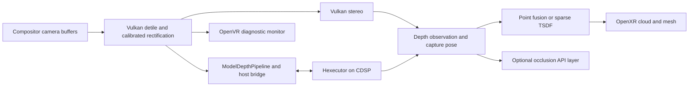

# System architecture

Frame Spatial Runtime turns headset stereo images into metric observations and world-space geometry. Hexecutor provides native Hexagon execution for learned inference. The model directories own model contracts, reference tools, and future training work; raw model artifacts stay local.

## Responsibility boundaries

| Component | Owns | Does not establish by itself |
| --- | --- | --- |
| `runtime/` | Camera acquisition, rectification, depth-to-metric conversion, poses, fusion, rendering, recording | A model's training provenance or a DSP kernel's numerical contract |
| `hexecutor/frame/` | Transport, private memory, native programs, kernels, clocks, scheduling, cleanup | Correct camera geometry or calibrated model confidence |
| `depth-model/` | Model extraction/reference tools, simulator adapters, tensor contracts, training workspace | A general inference engine for arbitrary exported graphs |
| `hand-tracking/` | Model workspace and compatibility research | A finished hand-tracking runtime |
| `tools/` | Artifact policy and repository checks | Distribution of weights or captures |

The render loop must continue locating and presenting the headset while depth work runs in the background. `runtime/src/cloud_worker.cpp` owns the depth/fusion worker. `openxr_point_cloud.cpp` presents the scene; `main.cpp` is the diagnostic application's entry point. The occlusion layer has its own publication/consumer contract.

For learned depth, Python carries socket messages and manages the DSP session. The retained runtime backends execute the graph on the DSP. The hybrid Python graph scheduler has been removed. CPU reference execution remains available for offline numerical comparison.

Camera ownership and DSP ownership are separate constraints. Capture borrows compositor-managed buffers; it must not compete for the physical sensors. A custom DSP session temporarily shares firmware infrastructure and may pause the eye client. It must restore its memory, clocks, callbacks, and worker state before that client resumes.

Compatibility links such as `depth-model/frame` and `hexecutor/recovered` connect the generic monorepo layout to tools that compute resource paths from resolved Python filenames. They are part of the resource contract, not duplicate source directories. Follow the source paths in each guide when changing implementation.
