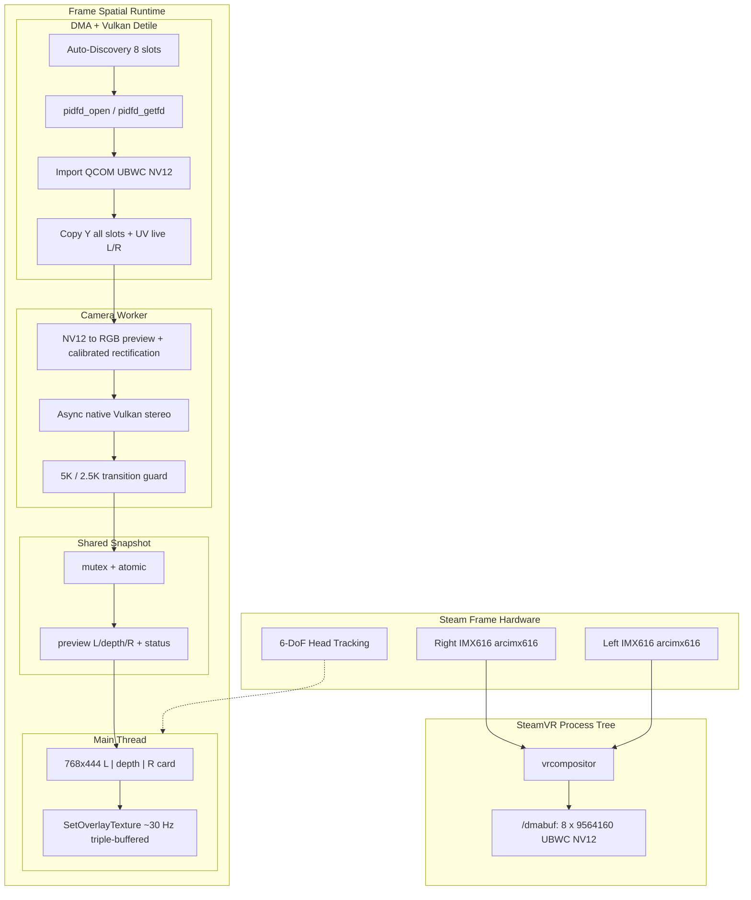

# System Architecture

## 1. Architectural Overview

The Frame Spatial Runtime is designed as a high-throughput, multi-threaded pipeline decoupled into two asynchronous loops:
1. **Camera Worker Thread**: DMA ingest + Vulkan UBWC detile (Y+UV), RGB preview conversion, and Arcturus mode-transition filtering.
2. **Main Render Thread**: 70–90 Hz OpenVR event loop; `SetOverlayTexture` (~30 Hz) using persistent Vulkan textures for an opaque stereo-camera HUD.

Authoritative HUD behavior: [`headset_rendering.md`](headset_rendering.md), [`progress_imx_monitor.md`](progress_imx_monitor.md).

---

## 2. Component Breakdown

### A. Zero-Copy Hardware DMA Ingestion (`DMACapture`)
* **Role**: Obtain compositor camera DMA-BUFs and Vulkan-detile them.
* **Mechanism**: `pidfd_open` / `pidfd_getfd`, import QCOM UBWC NV12, copy Y (all ring slots) and UV (live L/R).
* **Auto-Discovery**: Eight `/dmabuf:` FDs of size `9,564,160` → 4 right + 4 left (**IMX616 stereo RGB**).

### B. Camera Preview Pipeline
* **Role**: Produce stable 616×616 RGB views for both IMX616 cameras.
* **Mode changes**: Debounce the full-readout ↔ binned transition because Arcturus keeps the DMA allocation dimensions fixed while changing sensor mode.
* **Depth**: The worker performs full-extrinsic rectification and submits only the newest pair to native Vulkan census, bidirectional disparity, consistency, and support passes. CPU Census/WTA is the initialization/runtime failure fallback.
* **GPU arbitration**: Overlay texture uploads are deferred during stereo dispatch, preserving OpenVR polling and retaining the previous valid texture on screen.

### C. Overlay Renderer (`OverlayRenderer`)
* **Role**: Opaque head-locked diagnostic monitor (SBS off).
* **Key**: `frame.spatial.imx_monitor.vulkan`, 768×444, triple-buffered Vulkan texture upload because Frame SteamVR eventually rejects Raw uploads (`VROverlayError_RequestFailed`).
* **Content**: Left RGB | linear metric depth | Right RGB + FPS/frame telemetry.
