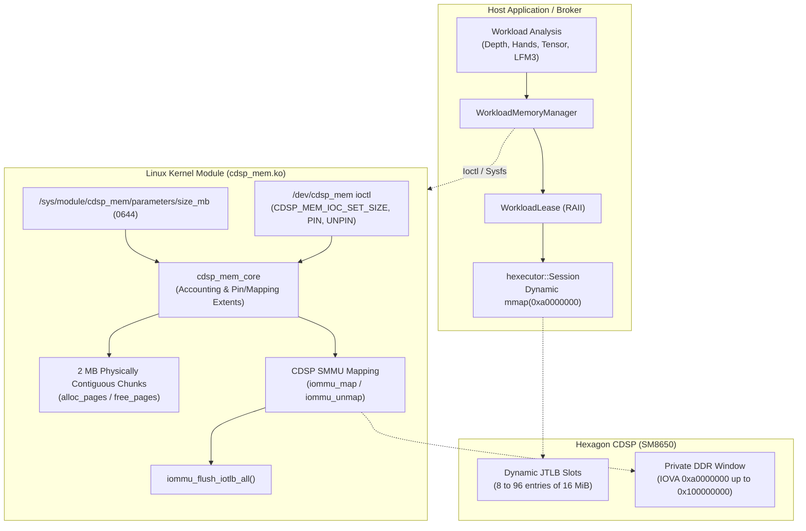

# Dynamic CDSP Memory Reservation

This document describes the design, implementation, and verification of dynamic CDSP memory growth and shrinking based on workloads, supporting allocations from the 128 MiB baseline up to 1.5 GiB (1536 MiB).

---

## 1. Context and Problem Statement

Historically, the Frame CDSP kernel driver (`cdsp_mem.ko`) allocated a static memory lease at module load time via the `size_mb` module parameter (e.g. `insmod cdsp_mem.ko size_mb=128`).
- **128 MiB** was the baseline contract for learned depth (`ModelDepthPipeline`) and MediaPipe/NIR hand tracking (`nirhands`).
- **512 MiB** was tested for multi-graph tensor models and enlarged constant pools.
- **Emerging workloads** such as Liquid AI's LFM3 family require significantly more CDSP memory:
  - *LFM3-1.7B Text Decoder (Q4_0, Host-Assisted Embeddings)*: requires **848 MiB** minimum (~1024 MiB recommended lease, 64 JTLB slots).
  - *LFM3-VL-2B Multimodal (Q4_0, Host-Assisted Embeddings)*: requires **982 MiB** minimum (~1280 MiB or 1536 MiB recommended lease, 80–96 JTLB slots).
  - *LFM3-VL-2B All-on-DSP (Q4_0, Token Embeddings on CDSP)*: requires **1140 MiB** minimum (~1536 MiB recommended lease, 96 JTLB slots).
  *(See budget reconciliation details below from [`docs/model-development/lfm3-dsp-plan.md`](../model-development/lfm3-dsp-plan.md)).*

A static lease presents a fundamental trade-off:
- If pinned to 128 MiB, large models cannot run.
- If permanently pinned to 1024–1536 MiB, lightweight tracking workloads permanently hold up to 1.5 GiB of headset system RAM, risking OS out-of-memory kills and starving graphics/compositor processes.

Dynamic memory reservation solves this by scaling the allocation up to the workload's exact requirement when active, and shrinking it back down to baseline (128 MiB) when idle or transitioning back to lightweight tracking.

---

## 2. Architecture Overview



---

## 3. Kernel Module Implementation (`cdsp_mem.c` & `cdsp_mem_core.c`)

The kernel module lives at [`hexecutor/device/kmod/cdsp_mem.c`](../../hexecutor/device/kmod/cdsp_mem.c) and [`hexecutor/device/kmod/cdsp_mem_core.c`](../../hexecutor/device/kmod/cdsp_mem_core.c) with public ABI constants in [`hexecutor/include/hexecutor/cdsp_mem.h`](../../hexecutor/include/hexecutor/cdsp_mem.h).

### 3.1 Constraints and Boundaries
- **Chunk granularity**: 2 MiB physically contiguous chunks (`CHUNK_ORDER 9`, `PAGE_SIZE << 9`).
- **Base IOVA**: `0xa0000000`.
- **Minimum size**: 128 MiB (64 chunks, 8 JTLB slots).
- **Maximum size**: 1536 MiB = 1.5 GiB (768 chunks, 96 JTLB slots).
  $$\text{0xa0000000} + \text{0x60000000 (1.5 GiB)} = \text{0x100000000 (4 GiB)}$$
  1536 MiB spans the entire remaining 32-bit IOVA space. Any allocation $> 1536$ MiB overflows 32-bit addressability and is rejected.

### 3.2 Dynamic Growth and Shrinking
Resizing is serialized under `cdsp_mem_lock` mutex:
1. **Growth (`new_size_mb > size_mb`)**:
   - Always allowed, regardless of active mappings or pins.
   - Allocates new pointer array for chunks.
   - Iterates `i` from `nchunks` to `new_nchunks - 1`:
     - Allocates 2 MiB chunk (`alloc_pages(GFP_KERNEL | __GFP_ZERO | __GFP_NOWARN, CHUNK_ORDER)`).
     - Maps DMA handle (`dma_map_page`).
     - Maps into CDSP IOMMU (`iommu_map(domain, iova + i * CHUNK_BYTES, ...)`).
   - Flushes SMMU context (`iommu_flush_iotlb_all(domain)`).
   - **Atomic rollback**: If any allocation or mapping fails, all chunks added in the current operation are unmapped, freed, and the previous reservation remains valid.
2. **Shrinking (`new_size_mb < size_mb`)**:
   - **Pinned & Mapped Extent Rule**: Evaluates the highest extent pinned by any active user VMA mapping or DSP session pin. If `new_size_mb < highest_pinned_extent`, the operation returns `-EBUSY`.
   - Shrinking down to or above the highest pinned extent is permitted.
   - Iterates top-down from `nchunks - 1` to `new_nchunks`:
     - Unmaps IOMMU page (`iommu_unmap`).
     - Unmaps DMA page (`dma_unmap_page`).
     - Frees physical pages back to kernel (`__free_pages`).
   - Flushes SMMU context (`iommu_flush_iotlb_all(domain)`).
   - Downsizes chunk pointer arrays.

### 3.3 Pin and Mapping Safety Rules
- **Live User VMA Tracking**: The driver tracks memory mappings using `struct vm_operations_struct` (`.open` and `.close`). When a process forks, splits VMAs, or unmaps regions, each VMA's extent (`vm_pgoff << PAGE_SHIFT + vm_end - vm_start`) is tracked in `cdsp_mem_core`. Chunks within any live mapping can never be freed while mapped.
- **DSP-Window Pin (`CDSP_MEM_IOC_PIN` / `CDSP_MEM_IOC_UNPIN`)**: An ioctl tied to the open `struct file *`. A session pins the extent the DSP engine touches. If a host process crashes or exits abruptly, the driver's `.release` callback automatically releases all pins registered by that file descriptor.
- **Concurrency**: `SET_SIZE`, `mmap`, `PIN`, and `UNPIN` are fully serialized under `cdsp_mem_lock` mutex. No sleeping memory allocations occur under a spinlock.

### 3.4 Permissions and Capabilities
- `/dev/cdsp_mem` device permissions remain `0666` (openable and mappable by unprivileged processes as required by existing client binaries).
- `CDSP_MEM_IOC_SET_SIZE` and the sysfs setter `/sys/module/cdsp_mem/parameters/size_mb` require `CAP_SYS_ADMIN` unless the module parameter `allow_user_resize=1` is passed (default: `0`).
- `CDSP_MEM_IOC_GET_SIZE`, `CDSP_MEM_IOC_GET_INFO`, and `PIN`/`UNPIN` remain unprivileged.
- **Process Privilege Breakdown**:
  - `hexecutord`: Runs models dynamically. If serving workloads that expand beyond 128 MiB (e.g. LFM3 or large tensor models), `hexecutord` requires `CAP_SYS_ADMIN` or running with `allow_user_resize=1`.
  - `frame_depth_worker`: Operates within the 128 MiB baseline without resizing; runs completely unprivileged.
  - `nirhands_replay` / hand viewer: Operates within the 128 MiB baseline without resizing; runs completely unprivileged.

---

## 4. Host Workload Management (`WorkloadMemoryManager`)

Implemented in [`hexecutor/host/cpp/workload_memory.cpp`](../../hexecutor/host/cpp/workload_memory.cpp) and [`hexecutor/include/hexecutor/workload_memory.hpp`](../../hexecutor/include/hexecutor/workload_memory.hpp).

### 4.1 Automatic Workload Sizing
`calculate_workload_size_mb(programs, artifacts)` evaluates the active workload:
- **Baseline Workloads**: Depth and hand tracking return `128 MiB`.
- **Tensor & QNN16 Workloads**: Sums engine ELF + program images + arenas + constant pools + I/O buffers + 32 MiB scratch/stacks/canaries.
- **Overrides**: Supports `Artifacts::cdsp_memory_mb` and `HEXECUTOR_CDSP_MEM_MB` environment variable.
- **Alignment**: Aligns up to 16 MiB boundaries and clamps to `[128, 1536]` MiB.

### 4.2 RAII Lease Pattern (`WorkloadLease`)
```cpp
{
    // Acquiring lease automatically grows cdsp_mem if needed
    auto lease = WorkloadMemoryManager::instance().acquire_lease(workload_mb);

    // Mmap and execute workload
    ...
} // Destruction automatically shrinks cdsp_mem back to baseline (128 MiB) if nothing else pins
```

### 4.3 Integration in `Session` (`executor.cpp`)
- `open()`: Calculates workload requirement, acquires `WorkloadLease`, queries actual driver lease size, opens `/dev/cdsp_mem`, takes the DSP-window pin via `CDSP_MEM_IOC_PIN(lease_mb)`, and calls `mmap(nullptr, mapped_bytes, ...)`.
- Constants Region: When `mapped_bytes > 128 MiB`, `allocation_limit` for constants dynamically expands beyond 96 MiB up to `mapped_bytes - 32 MiB`.
- Guards: Dynamic top-of-window canary guard placed at `mapped_bytes - 4096`.
- `close()`: After `verify_exit(ran)` finishes and succeeds, calls `CDSP_MEM_IOC_UNPIN` and closes the device handle.
- `release_memory()`: Unmaps memory (`munmap`) and releases `WorkloadLease`. If the driver returns `-EBUSY` (another process or mapping is holding the window), the host manager treats `-EBUSY` as 'stay large' without crashing.

### 4.4 Idle-Close and Persistent-State Interplay
- `hexecutord` supports `--idle-close-ms` to release the device during idle periods.
- Persistent DSP state (KV cache for attention layers and causal 1D conv historical buffers) resides in the lease window.
- If the lease were to shrink below the persistent state region, this state would be lost.
- `WorkloadMemoryManager::set_persistent_state_pin(state_mb)` exposes a hook for persistent-state owners: while live, shrink requests below `state_mb` are refused, keeping the memory lease preserved across idle cycles.

---

## 5. Hexagon JTLB and Transport Adaptations

### 5.1 Dynamic JTLB Slot Placement (`qd_owned_memory.h`)
Hexagon JTLB provides 128 entries (indices `0..127`). Firmware / QuRT OS entries occupy slots `0..11`.
Each JTLB slot maps a 16 MiB page (`0x40` encoding).

The starting entry index `QDO_FIRST` adapts based on `QDO_SLOTS`:
$$\text{QDO\_FIRST} = \begin{cases} 64 & \text{if } \text{QDO\_SLOTS} \le 64 \\ 128 - \text{QDO\_SLOTS} & \text{if } \text{QDO\_SLOTS} > 64 \end{cases}$$

| Window Size | JTLB Slots (16 MiB) | Slot Indices | Headroom / Firmware Conflict |
| :--- | :---: | :---: | :--- |
| **128 MiB** (shipped) | 8 | 64..71 | None (slots 12..63 and 72..127 free) |
| **256 MiB** | 16 | 64..79 | None |
| **512 MiB** (experimental) | 32 | 64..95 | None |
| **1024 MiB** (LFM3 Text) | 64 | 64..127 | None |
| **1536 MiB** (LFM3-VL) | 96 | 32..127 | None (entries 0..31 preserved for firmware) |

### 5.2 Transport and Probe Updates (`frame_transport.cpp`)
- `verify_chunk_map()` accepts windows up to 1536 MiB (`window_mb <= 1536`).
- Nonce random bits masking updated for $> 512$ MiB (`~0x7fe00000u`) to clear 10 chunk-index bits, ensuring no hash collisions across all 768 chunks.

---

## 6. Verification and Test Taxonomy

The test suite separates mock-level tests, real-core logic tests, and device-staged test plans:

### 6.1 Real-Core C Driver Tests (`test_cdsp_mem_core`)
Target `test_cdsp_mem_core` compiles the pure C kernel core (`cdsp_mem_core.c`) directly on macOS using a fake kernel ops table without kernel headers:
1. **Physical Allocation & Mapping**: Verifies 2 MiB chunk allocation, IOMMU mapping, and SMMU context invalidation.
2. **Atomic Rollback on Injected Failure**: Systematically injects allocation and mapping failures at **every individual chunk index** from 64 to 127 (growing 128 to 256 MiB) and across sample indices up to 768 (1.5 GiB). Verifies 100% clean rollback with 0 leaked chunks or IOVA mappings.
3. **Live User VMA Tracking & -EBUSY Rules**: Simulates VMA mappings, verifies -EBUSY when shrink $< \text{highest VMA extent}$, verifies shrink down to exact extent, and checks automatic extent reduction on VMA close.
4. **DSP-Window Pin / Unpin Rules**: Verifies pin enforcement, -EBUSY on shrink, and unpin release.
5. **Multi-Threaded Concurrency**: 8 concurrent threads executing simultaneous resize, pin, unpin, and mapping calls under mutex serialization.
6. **Teardown**: Full unmap and free of all chunks with zero memory leaks.

### 6.2 Host Workload Manager Mock Tests (`test_dynamic_cdsp_mem`)
Target `test_dynamic_cdsp_mem` tests `WorkloadMemoryManager` and `WorkloadLease` using mock mode:
1. **Step-wise Growth & Shrinking**: 128 to 1536 MiB and back.
2. **Boundary Enforcement**: Rejection of $< 128$ MiB and $> 1536$ MiB.
3. **RAII Lease Move & Nesting**: Retention of peak reservation until all consumers release.
4. **Persistent State Pinning**: Verification that live persistent state prevents lease shrink.
5. **EBUSY Handling**: Verification that driver -EBUSY is handled gracefully as 'stay large'.
6. **Multi-Threaded Leases**: 8 concurrent threads acquiring and releasing leases.

### 6.3 Python Offline Mock Suite (`test_cdsp_mem_dynamic.py`)
Python unit tests with mocked sysfs and `/dev/cdsp_mem` paths validating sizing bounds and context manager lifecycle.

### 6.4 Frame Device Staged Test Plan (`dynamic_mem_stage_test.sh`)
Located at [`hexecutor/device/kmod/dynamic_mem_stage_test.sh`](../../hexecutor/device/kmod/dynamic_mem_stage_test.sh). Designed to run directly on the Steam Frame headset (requires user watching for insmod and dmesg monitoring):
- **Step 0**: Frame DSP state check (`depth_state.py`, control `[1,0,1]`).
- **Step 1**: Insmod / check baseline 128 MiB reservation.
- **Step 2**: Staged growth $128 \to 256 \to 512 \to 768 \to 1024$ MiB with read-only chunk probe (`hexecutor_chunk_probe`), aborting on any dmesg SMMU fault.
- **Step 3**: Ioctl safety validation (live mmap blocks shrink with -EBUSY; pin blocks shrink; killing pinning process releases pin).
- **Step 4**: Shrink back to 128 MiB baseline.

---

## 7. Unverified Device Items (Frame Hardware Dependencies)

The following items cannot be fully verified from the macOS host or simulator and require execution of the staged test plan on hardware:
1. **JTLB Slots 96..127 and 32..63 Firmware Headroom**:
   - *Status*: QuRT and Valve's `dsp_service` occupy slots 0..11. Slots 64..71 (128 MiB) and 64..95 (512 MiB) are proven clean. Slots 32..63 and 96..127 have not been read on physical device during concurrent XRService execution. `qd_owned_memory.h` verifies that target slots are clear before writing, but confirmation that no firmware threads map slots 32..63 remains unverified on hardware.
2. **CDSP SMMU Aperture (0xa0000000..0x100000000)**:
   - *Status*: The 512 MiB window (`0xa0000000..0xc0000000`) is verified. The upper 1 GiB (`0xc0000000..0x100000000`) must be confirmed free of conflicts with any peripheral or GPU SMMU mappings.
3. **Physical DDR Contiguity for ~768 Order-9 Allocations**:
   - *Status*: 768 contiguous 2 MiB allocations require 1.5 GiB of unfragmented RAM. On a booted headset with long uptime, memory compaction (`echo 1 > /proc/sys/vm/compact_memory`) may be required before `insmod` or large growth. Atomic rollback guarantees system stability on allocation failure, but allocation success rate at runtime under memory pressure is unverified on device.
4. **DSP Execution with Constants $> 512$ MiB**:
   - *Status*: Physical execution of models exceeding 512 MiB on the Hexagon NPU hardware.
