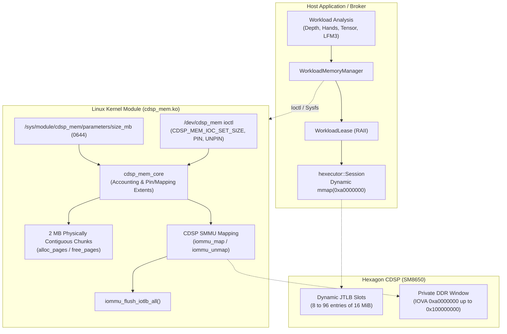

# Dynamic CDSP Memory Reservation

This document describes the design, implementation, and verification of dynamic CDSP memory growth and shrinking based on workloads, supporting allocations from the 128 MiB baseline up to 1.5 GiB (1536 MiB).

---

## Lease sizing

The ordinary depth and small tracking configurations use a 128 MiB baseline. Large tensor models may require a larger mutually compatible kernel lease and engine, bootstrap and probe. Size the window against actual arenas, constants, state and guard layout, using the exported manifest. [Recorded lease tests](#recorded-evidence-and-release-checks)

## Architecture Overview



---

## Kernel Module Implementation (`cdsp_mem.c` & `cdsp_mem_core.c`)

The kernel module lives at [`hexecutor/device/kmod/cdsp_mem.c`](../../hexecutor/device/kmod/cdsp_mem.c) and [`hexecutor/device/kmod/cdsp_mem_core.c`](../../hexecutor/device/kmod/cdsp_mem_core.c) with public ABI constants in [`hexecutor/include/hexecutor/cdsp_mem.h`](../../hexecutor/include/hexecutor/cdsp_mem.h).

### Constraints and Boundaries
- **Chunk granularity**: 2 MiB physically contiguous chunks (`CHUNK_ORDER 9`, `PAGE_SIZE << 9`).
- **Base IOVA**: `0xa0000000`.
- **Minimum size**: 128 MiB (64 chunks, 8 JTLB slots).
- **Maximum size**: 1536 MiB = 1.5 GiB (768 chunks, 96 JTLB slots).
  $$\text{0xa0000000} + \text{0x60000000 (1.5 GiB)} = \text{0x100000000 (4 GiB)}$$
  1536 MiB spans the entire remaining 32-bit IOVA space. Any allocation $> 1536$ MiB overflows 32-bit addressability and is rejected.

### Dynamic Growth and Shrinking
Resizing is serialized under `cdsp_mem_lock` mutex:
1. **Growth (`new_size_mb > size_mb`)**:
   - Always allowed, regardless of active mappings or pins.
   - Allocates new pointer array for chunks.
   - Iterates `i` from `nchunks` to `new_nchunks - 1`:
     - Allocates 2 MiB chunk (`alloc_pages(GFP_KERNEL | __GFP_ZERO | __GFP_NOWARN, CHUNK_ORDER)`).
     - Maps DMA handle (`dma_map_page`).
     - Maps into CDSP IOMMU (`iommu_map(domain, iova + i * CHUNK_BYTES, ...)`).
   - Flushes SMMU context (`iommu_flush_iotlb_all(domain)`).
   - **Atomic rollback**: If any allocation or mapping fails, all chunks added in the current operation are unmapped, freed, and the previous reservation remains valid.
2. **Shrinking (`new_size_mb < size_mb`)**:
   - **Pinned & Mapped Extent Rule**: Evaluates the highest extent pinned by any active user VMA mapping or DSP session pin. If `new_size_mb < highest_pinned_extent`, the operation returns `-EBUSY`.
   - Shrinking down to or above the highest pinned extent is permitted.
   - Iterates top-down from `nchunks - 1` to `new_nchunks`:
     - Unmaps IOMMU page (`iommu_unmap`).
     - Unmaps DMA page (`dma_unmap_page`).
     - Frees physical pages back to kernel (`__free_pages`).
   - Flushes SMMU context (`iommu_flush_iotlb_all(domain)`).
   - Downsizes chunk pointer arrays.

### Pin and Mapping Safety Rules
- **Live User VMA Tracking**: The driver tracks memory mappings using `struct vm_operations_struct` (`.open` and `.close`). When a process forks, splits VMAs, or unmaps regions, each VMA's extent (`vm_pgoff << PAGE_SHIFT + vm_end - vm_start`) is tracked in `cdsp_mem_core`. Chunks within any live mapping can never be freed while mapped.
- **DSP-Window Pin (`CDSP_MEM_IOC_PIN` / `CDSP_MEM_IOC_UNPIN`)**: An ioctl tied to the open `struct file *`. A session pins the extent the DSP engine touches. If a host process crashes or exits abruptly, the driver's `.release` callback automatically releases all pins registered by that file descriptor.
- **Concurrency**: `SET_SIZE`, `mmap`, `PIN`, and `UNPIN` are fully serialized under `cdsp_mem_lock` mutex. No sleeping memory allocations occur under a spinlock.

### Permissions and Capabilities
- `/dev/cdsp_mem` device permissions remain `0666` (openable and mappable by unprivileged processes as required by existing client binaries).
- `CDSP_MEM_IOC_SET_SIZE` and the sysfs setter `/sys/module/cdsp_mem/parameters/size_mb` require `CAP_SYS_ADMIN` unless the module parameter `allow_user_resize=1` is passed (default: `0`).
- `CDSP_MEM_IOC_GET_SIZE`, `CDSP_MEM_IOC_GET_INFO`, and `PIN`/`UNPIN` remain unprivileged.
- **Process Privilege Breakdown**:
  - `hexecutord`: Runs models dynamically. If serving workloads that expand beyond 128 MiB (e.g. LFM3 or large tensor models), `hexecutord` requires `CAP_SYS_ADMIN` or running with `allow_user_resize=1`.
  - `frame_depth_worker`: Operates within the 128 MiB baseline without resizing; runs completely unprivileged.
  - `nirhands_replay` / hand viewer: Operates within the 128 MiB baseline without resizing; runs completely unprivileged.

---

## Host Workload Management (`WorkloadMemoryManager`)

Implemented in [`hexecutor/host/cpp/workload_memory.cpp`](../../hexecutor/host/cpp/workload_memory.cpp) and [`hexecutor/include/hexecutor/workload_memory.hpp`](../../hexecutor/include/hexecutor/workload_memory.hpp).

### Automatic Workload Sizing
`calculate_workload_size_mb(programs, artifacts)` estimates the required lease from a 1 MiB engine reservation, the image and constant file sizes, declared I/O bytes and 32 MiB of shared overhead. It rounds the estimate to 16 MiB and uses at least the 128 MiB baseline. `Artifacts::cdsp_memory_mb` and `HEXECUTOR_CDSP_MEM_MB` can raise the requested size within the configured cap. The estimate does not replace the engine's window and layout checks. [Workload sizing](../../hexecutor/host/cpp/workload_memory.cpp)

### RAII Lease Pattern (`WorkloadLease`)
```cpp
{
    // Acquiring lease automatically grows cdsp_mem if needed
    auto lease = WorkloadMemoryManager::instance().acquire_lease(workload_mb);

    // Mmap and execute workload
    ...
} // Destruction automatically shrinks cdsp_mem back to baseline (128 MiB) if nothing else pins
```

### Integration in `Session` (`executor.cpp`)
- `open()`: Calculates workload requirement, acquires `WorkloadLease`, queries actual driver lease size, opens `/dev/cdsp_mem`, takes the DSP-window pin via `CDSP_MEM_IOC_PIN(lease_mb)`, and calls `mmap(nullptr, mapped_bytes, ...)`.
- Constants Region: For HXFG pools that exceed the standard allocation, and an engine window above 128 MiB, the high region begins at 128 MiB and ends at the smaller of the engine window minus 8 KiB and the format ceiling. Persistent state follows the constants.
- Guards: Dynamic top-of-window canary guard placed at `mapped_bytes - 4096`.
- `close()`: After `verify_exit(ran)` finishes and succeeds, calls `CDSP_MEM_IOC_UNPIN` and closes the device handle.
- `release_memory()`: Unmaps memory (`munmap`) and releases `WorkloadLease`. If the driver returns `-EBUSY` (another process or mapping is holding the window), the host manager treats `-EBUSY` as 'stay large' without crashing.

### Persistent state

The broker keeps sessions with persistent graphs open through routine idle gaps. A forced release loses that state and requires explicit reset before subsequent use. The workload manager also exposes a persistent pin for callers that own such a lease. [Broker lifecycle](broker.md#persistent-state)

## Hexagon JTLB and Transport Adaptations

### Dynamic JTLB Slot Placement (`qd_owned_memory.h`)
Hexagon JTLB provides 128 entries (indices `0..127`). Firmware / QuRT OS entries occupy slots `0..11`.
Each JTLB slot maps a 16 MiB page (`0x40` encoding).

The standard eight-slot build uses indices 64–71. Builds with more than eight slots search for free entries from 127 down to 16 and save their original values. Installation refuses a conflicting virtual mapping or insufficient free slots. Restore and verify all saved entries at exit. `QDO_SLOTS` is an engine/bootstrap build setting. [JTLB implementation](../../hexecutor/native/qd_owned_memory.h)

### Transport and Probe Updates (`frame_transport.cpp`)
- `verify_chunk_map()` accepts windows up to 1536 MiB (`window_mb <= 1536`).
- Nonce random bits masking updated for $> 512$ MiB (`~0x7fe00000u`) to clear 10 chunk-index bits, ensuring no hash collisions across all 768 chunks.

---

## Verification

The test suite separates mock-level tests, real-core logic tests, and device-staged test plans:

### Real-Core C Driver Tests (`test_cdsp_mem_core`)
Target `test_cdsp_mem_core` compiles the pure C kernel core (`cdsp_mem_core.c`) directly on macOS using a fake kernel ops table without kernel headers:
1. **Physical Allocation & Mapping**: Verifies 2 MiB chunk allocation, IOMMU mapping, and SMMU context invalidation.
2. **Atomic Rollback on Injected Failure**: Systematically injects allocation and mapping failures at **every individual chunk index** from 64 to 127 (growing 128 to 256 MiB) and across sample indices up to 768 (1.5 GiB). Verifies 100% clean rollback with 0 leaked chunks or IOVA mappings.
3. **Live User VMA Tracking & -EBUSY Rules**: Simulates VMA mappings, verifies -EBUSY when shrink $< \text{highest VMA extent}$, verifies shrink down to exact extent, and checks automatic extent reduction on VMA close.
4. **DSP-Window Pin / Unpin Rules**: Verifies pin enforcement, -EBUSY on shrink, and unpin release.
5. **Multi-Threaded Concurrency**: 8 concurrent threads executing simultaneous resize, pin, unpin, and mapping calls under mutex serialization.
6. **Teardown**: Full unmap and free of all chunks with zero memory leaks.

### Host Workload Manager Mock Tests (`test_dynamic_cdsp_mem`)
Target `test_dynamic_cdsp_mem` tests `WorkloadMemoryManager` and `WorkloadLease` using mock mode:
1. **Step-wise Growth & Shrinking**: 128 to 1536 MiB and back.
2. **Boundary Enforcement**: Rejection of $< 128$ MiB and $> 1536$ MiB.
3. **RAII Lease Move & Nesting**: Retention of peak reservation until all consumers release.
4. **Persistent State Pinning**: Verification that live persistent state prevents lease shrink.
5. **EBUSY Handling**: Verification that driver -EBUSY is handled gracefully as 'stay large'.
6. **Multi-Threaded Leases**: 8 concurrent threads acquiring and releasing leases.

### Python Offline Mock Suite (`test_cdsp_mem_dynamic.py`)
Python unit tests with mocked sysfs and `/dev/cdsp_mem` paths validating sizing bounds and context manager lifecycle.

### Frame Device Staged Test Plan (`dynamic_mem_stage_test.sh`)
Located at [`hexecutor/device/kmod/dynamic_mem_stage_test.sh`](../../hexecutor/device/kmod/dynamic_mem_stage_test.sh). Designed to run directly on the Steam Frame headset (requires user watching for insmod and dmesg monitoring):
- **Step 0**: Frame DSP state check (`depth_state.py`, control `[1,0,1]`).
- **Step 1**: Insmod / check baseline 128 MiB reservation.
- **Step 2**: Staged growth $128 \to 256 \to 512 \to 768 \to 1024$ MiB with read-only chunk probe (`hexecutor_chunk_probe`), aborting on any dmesg SMMU fault.
- **Step 3**: Ioctl safety validation (live mmap blocks shrink with -EBUSY; pin blocks shrink; killing pinning process releases pin).
- **Step 4**: Shrink back to 128 MiB baseline.

---

## Recorded evidence and release checks

Read-only device probes covered 128–512 MiB in the 2026-11-17 session. A matched experimental 80-slot build ran a staged tensor workload with a 1,280 MiB lease on 2026-11-19. That run demonstrates a large-window data path for its firmware, engine and workload. Verify slot availability, the SMMU aperture and cleanup under the target firmware and concurrent clients. [Device evidence](validation.md#recorded-frame-results)

The configured maximum still requires target-specific coverage. Validate allocation under realistic memory pressure, rollback after failed growth, and return to the baseline following process exit. Large windows require many independently contiguous 2 MiB chunks. A simulated allocation success does not establish that the target kernel can allocate those chunks during a long-running headset session.
