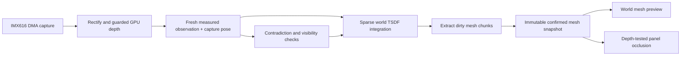

# Persistent room mesh and occlusion plan

Status: proposed design and staged implementation, 2026-10-07. Build a room
surface that persists in world space, is refined by fresh guarded stereo
observations, and supplies occlusion after confirmation. Mesh construction
must not block headset rendering.

## Starting point and chosen design

The point-cloud viewer already fuses repeat-observed points into 2 cm
stage-space voxels. The occlusion worker instead smooths/completes the current
camera depth, reprojects image-space history, confirms samples and triangulates
a depth grid. That surface is bounded by observation ages, tied to the current
camera view, and not a persistent volumetric room map. Brief empty submissions
now have a 250 ms capture grace period, but view changes, projection loss and
expiry can still reduce its coverage.

Use a **sparse, block-hashed TSDF** (truncated signed distance field), initially
integrated on the CPU in a worker. Extract only changed blocks into world-space
mesh chunks and publish immutable snapshots. Keep the existing point cloud and
depth-grid occlusion as comparison/fallback modes. Use OpenXR capture poses;
do not add a second tracking system in the first version.

Volumetric depth fusion has a primary precedent in
[KinectFusion](https://www.microsoft.com/en-us/research/publication/kinectfusion-real-time-dense-surface-mapping-tracking/).
Sparse voxel blocks are described in the
[InfiniTAM framework paper](https://www.robots.ox.ac.uk/~lav/Papers/prisacariu_etal_arxiv2017/prisacariu_etal_arxiv2017.pdf).
These motivate the representation; they do not establish its performance or
accuracy on this headset's passive stereo. Our initial 8³ blocks, 2 cm cells,
budgets and validation policies below are project design choices.



## Observation contract before integration

Introduce a `DepthObservation` carrying a unique accepted-pair ID, both camera
hashes, monotonic capture interval/midpoint, OpenXR capture pose, rectified
intrinsics, optical-to-head transform, calibration ID and tracking-space epoch.
Include cleaned measured metric Z, valid-depth mask and explicit evidence.
Transfer ownership of processed arrays through a bounded queue; never copy raw
DMA slots to another process. Reject duplicates exactly as the existing worker
does: both selected camera hashes must change to count another observation.

Integrate only successfully located capture poses. Rendering can use the latest
predicted pose; reconstruction cannot substitute it for the capture pose.
Sensor exposure time is still unknown, so the DMA-read midpoint remains an
approximation. Log capture-to-publication age and test slow versus fast turns
for misregistration before reducing voxel size.

Measured, locally supported, LR-consistent guarded depth is the initial fusion
input. Do not feed plane-completed pixels or mesh predictions back as independent
measurements. Begin with the existing 0.25–5 m depth limits and speckle filter.
If weights need best cost, uniqueness, support samples or valid descriptor bits,
add a compact production evidence output rather than read back all diagnostics.
Those fields are engineering evidence, not calibrated probabilities.

## TSDF integration and confirmation

Define voxel blocks in OpenXR `STAGE` coordinates with signed integer block
keys; test negative coordinates and floor division. Start with 2 cm voxels and
8 × 8 × 8 cells per block (16 cm block width). Unknown cells have zero weight;
zero weight must not mean observed free space or a measured surface.

For each allocated voxel center, transform world → capture head → calibrated
rectified left camera, project into measured depth, and evaluate signed distance
`s = measuredZ - voxelZ`. Normalize/clamp within a truncation band `mu`:

```text
f = clamp(s / mu, -1, +1)
Dnew = (Wold * Dold + w * f) / (Wold + w)
Wnew = min(Wmax, Wold + w)
```

Update only eligible measured rays and cells within the observation band;
do not integrate behind the band or turn invalid depth into free-space carving.
Define the weighting recurrence explicitly at saturation so new observations
continue to refine a capped model. Each pair contributes at most once per
voxel, regardless of how many image samples reach it.

Start with a 6 cm minimum truncation band and test a distance-aware band using
`sigmaZ ≈ Z² * sigmaDisparity / (focal * baseline)`. The initial disparity-error
assumption (e.g. 0.75 px, already used by point visibility checks) is a tuning
parameter, not uncertainty ground truth. Near depth edges, avoid interpolation
across foreground/background and reject inconsistent normals/unsupported cells.
Choose/freeze weighting, band limits and edge gates through replay before
using the mesh for occlusion.

Store distance, bounded weight, independent observation count, direct-measurement
time and evidence flags. Confirm a surface only after at least three distinct
accepted pairs and neighboring measured support. An inferred plane cannot
increment that count. Refine confirmed geometry on agreement; do not globally
erase it because a new image has holes.

## Map persistence, dynamic objects and resets

Separate **stored map geometry** from **geometry eligible to occlude now**.
Looking away or a brief empty render submission does not destroy the map.
Stored geometry can be retained for revisits/export after its visibility
eligibility expires. Dynamic contradictions and map-space changes are local
or epoch-based invalidations, not reasons to rebuild the whole room every pair.

Project existing surface patches into the current measured depth and classify
reliable observations using calibrated transforms and range-dependent tolerance:

| Observation | Map / occlusion action |
| --- | --- |
| Depth agrees with the mapped surface | Refine distance/normal, renew direct support, clear contradiction evidence |
| Reliable depth lies behind the mapped surface | Suppress that patch's occlusion immediately; accumulate independent free-space evidence and remove/rebuild it after confirmation |
| Reliable depth lies in front | Preserve hidden background; consider foreground as a new candidate, without carving the background |
| Missing depth, weak support, glare, out of view | No contradiction or observation-count increment; retain stored geometry, age occlusion eligibility |
| Capture pose unavailable | Skip integration and mask publication; preserve the map for later revalidation |
| Known rigid tracking-space transform | Transform the map atomically into the new epoch |
| Unknown recenter/relocalization or calibration change | Quarantine old epoch and start a new map; never mix coordinate systems |

Free-space removal must require spatially supported real depth and multiple
distinct pairs, with counters stored separately from TSDF weight. Reuse the
reasoning and synthetic cases in `cloud_visibility.hpp`, but evaluate its
five-check/one-second policy at the guarded cadence before copying it unchanged.
A weight-capped TSDF must not require hundreds of frames to remove a moved chair.

Initial static-mesh visibility budget for testing: up to five seconds since
direct supported observation, with measured contradiction suppression on the
next fresh pair. Revalidate a retained confirmed patch on a reliable agreeing
observation when revisiting it; do not demand another global reconstruction.
Use a separate short-lived foreground overlay only after depth publication
latency supports it. At roughly 0.8 seconds per pair, prompt hand occlusion is
not established; a persistent mesh cannot fix sensor/matcher latency.

Five seconds is a proposed comparison setting, not permission to hold arbitrary
uncertain surfaces forever. Report expiry-driven flicker versus false masking
and moving-object trails before choosing a default. Completion can remain an
explicit preview layer; it must not silently harden into the permanent map.

## Incremental extraction and publication

Mark changed TSDF blocks and adjoining extraction cells dirty. Use marching
cubes with consistent block-boundary samples, triangle winding and shared
edge ownership. Read a one-voxel neighbor halo, avoid crossings through unknown
cells, and test ambiguous cases/continuity. Do not generate caps across
unobserved space merely to make the mesh watertight. Normals come from supported
TSDF gradients; insufficient support leaves a hole.

Associate each mesh chunk with block key, map epoch, geometry revision,
confirmation/evidence state and support deadlines. Changed or removed chunks
replace their predecessors; unchanged chunks persist. Attribute triangle
eligibility conservatively to its supporting samples, including expiry or
contradictions inside a cell, rather than assigning the whole map a new age.
Updates to deadlines must publish even when vertex positions do not change.

Keep integration/extraction in one owning map worker initially. Depth produces
a bounded latest-observation queue; replaced unprocessed observations are
counted as drops and must not cause artificial confirmation. Relative transforms
must come from the actual capture poses, not an assumption that no frames dropped.
Publish immutable snapshots/revisions through a short pointer exchange. The
render thread never waits for integration, extraction or the queue.

Start with bounded triangle lists compatible with `OcclusionRenderer`, then add
chunk-aware buffers if flattening/upload is expensive. Upload a new revision
only once; fence-protect buffer reuse and coordinate runtime Vulkan queue access.
Keep the existing matching batches; adding a GPU mesher in a separate worker
would still contend with graphics. Both eyes use one consistent map revision
and current OpenXR view/FOV with the application's submitted depth metadata.

The current `PointVertex.lifetime`/cloud-wide capture time describes a camera
surface. A persistent map needs per-chunk or per-vertex **absolute support
deadlines**, translated to render-relative time. Introduce a dedicated mesh
publication type and adapt `OcclusionRenderer` and `shaders/occlusion.*`;
repeated snapshot upload must not refresh support. Keep a compatible adapter
for the old depth-grid mode rather than reinterpreting `gCloud` silently.

## Initial resource and scheduling budgets

These are limits to implement and measure, not hardware capacity claims:

| Resource | Starting budget / overflow policy |
| --- | --- |
| Voxel payload | 8,192 blocks × 512 cells × planned 16 bytes = 64 MiB; assert layout size |
| Hash/index/contradiction metadata and scratch | Separately cap at 16 MiB; include allocator overhead in accounting |
| Published mesh | 128,000 triangles; at 20-byte triangle-list vertices, two snapshots consume about 14.6 MiB before chunk metadata/GPU duplication |
| Whole feature | Initial 128 MiB additional CPU+GPU target; account for duplicated upload buffers and revise the above caps if necessary |
| Integration/extraction | Start with ≤20 ms worker slices; process dirty blocks incrementally |
| Rendering | Preserve ≥70 FPS; target ≤2 ms p95 extra CPU submission work, measure GPU contention separately |

When full, evict unconfirmed/old out-of-view blocks first; prioritize confirmed
nearby visible surfaces. Never invalidate a published buffer during eviction.
If extraction exceeds the triangle cap, reduce detail by chunk or defer chunks
with explicit coverage metrics; do not leave triangles crossing removed blocks.
No render-frame allocation proportional to room size. Freeze allocations/limits
in the benchmark manifest before testing memory-pressure behavior.

## Delivery milestones and dependencies

| Milestone | Concrete work | Required exit evidence |
| --- | --- | --- |
| M0: observation/replay contract | Add proposed `depth_observation.hpp`; matcher/evidence/pose/epoch manifest; reason-coded resets and benchmark age parity | Duplicates, capture gaps, skipped frames, bad poses and epoch changes handled deterministically |
| M1: CPU sparse fusion | Proposed `room_mesh.hpp` / `room_mesh.cpp`; block allocation, measured-only integration, confirmation, budgets | Planes/slopes refine; transient mismatches do not become surfaces; count/weight saturation and memory caps pass |
| M2: world mesh preview | Dirty-block extraction, halos, normals, immutable snapshots; add mesh preview mode to `openxr_point_cloud.cpp` | Stable world geometry on head turns/revisits; block boundaries continuous; no triangles across unknown/depth steps |
| M3: change handling | Reliable free-space checks, patch suppression/removal, support deadlines, map epochs | Moving foreground/background, missing depth and tracking-space tests pass; old map never masks in the wrong epoch |
| M4: panel mesh occlusion | New publication type, chunk/deadline rendering adapter and mask shaders; proposed `FRAME_OCCLUSION_GEOMETRY=mesh` | Correct two-eye masks, application depth comparison, expired chunks fail open, render cadence remains acceptable |
| M5: optimization and evaluation | Worker/GPU timing, bounded upload/extraction, ten-minute room test; optional indexed buffers/GPU integration later | Measured stability improvement without worse contradiction persistence, bounded memory and sustained cadence |

M0–M3 precede mesh-based panel occlusion. The current depth-grid mode remains
available during development. No deployment, new settings, file formats or
meshing implementation are created by this planning document.

## Verification and decision gates

Synthetic/replay tests should include metric planes and slopes, thin silhouettes,
disconnected objects, noisy/clipped observations, missing regions, repeated
pair IDs, camera translations/rotations, negative block keys, boundary cells,
changed furniture, near foreground protecting background, and recentering.
Verify mesh normals/winding, unknown-space holes, deterministic CPU replay,
deadline monotonicity, chunk removal and safe snapshot/buffer ownership.

Extend the existing still/head-turn/hand-motion/recovery protocol with look-away
and return, a moved chair, capture pauses and forced memory pressure. Capture
map revisions, per-chunk additions/removals/expiry, direct-support ages,
integration/extraction/upload times and actual rendered mask changes. The
existing benchmark is an image-space support/contradiction proxy; it does not
measure true eye-mask flicker or ground-truth depth.

Proposed acceptance gates: at least 50% reduction in still-scene supported-area
flicker versus the current guarded depth-grid mode on matched sequences; no
increase in measured-contradiction persistence; independent confirmation before
occlusion; expired/invalid-epoch geometry masks nothing; ≥70 sustained focused
FPS; no unbounded queues or allocations during a ten-minute scan. Report both
coverage and erroneous masking so deleting geometry cannot appear to win.
First measure baseline variance, then freeze numerical gates before comparing
candidate settings. A wearer review and dimensioned planar target provide
additional evidence; a visually smoother mesh alone does not establish accuracy.

Begin with M0 and a deterministic CPU plane-fusion prototype, alongside the
[matcher profiling plan](stereo_guarded_optimization_plan.md). GPU fusion,
mesh-guided stereo search, export/physics APIs and persistent storage follow
after correctness and panel behavior are established.
